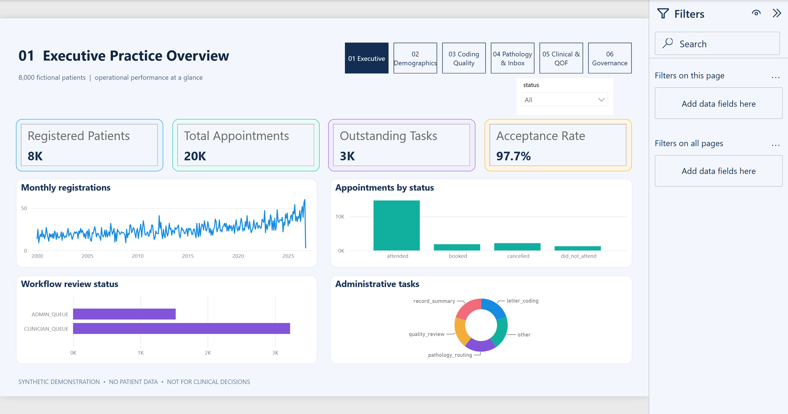
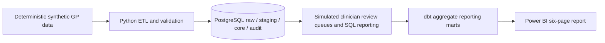

# NHS Primary Care Data Management & Clinical Intelligence Platform

[](https://github.com/tosinmulero/nhs-primary-care-intelligence-platform/actions/workflows/portfolio-quality.yml)


> **Independent, entirely synthetic portfolio demonstration.** Not affiliated with or endorsed by the NHS or Guide Post Medical Group. Not intended for clinical use or real patient decisions.

A Python, PostgreSQL, SQL, dbt and **Power BI PBIP/PBIR** portfolio case study modelling a hypothetical GP practice with 8,000 fictional patients. It demonstrates data quality controls, simulated correspondence/pathology review queues, management reporting and a six-page visual analytics experience.

## Recruiter quick review

**[Read the dedicated portfolio case study](https://tosinmulero.github.io/data-analytics-portfolio/case-studies/nhs-primary-care-intelligence-platform.html)** · **[Open the evidence guide](docs/RECRUITER_GUIDE.md)** · [View a project visual](docs/images/page-01-executive.png)

The evidence guide links the business question, documented results, methodology and source artefacts without relying on unverified claims.

## Executive dashboard



## All six pages

| Dashboard | Genuine Power BI capture |
|---|---|
| Executive Practice Overview | [View](docs/images/page-01-executive.png) |
| Patient Demographics | [View](docs/images/page-02-demographics.png) |
| Clinical Coding & Record Quality | [View](docs/images/page-03-coding-quality.png) |
| Pathology & Correspondence | [View](docs/images/page-04-pathology.png) |
| Clinical Searches & QOF-style Intelligence | [View](docs/images/page-05-clinical-qof.png) |
| Data Governance & Operational Performance | [View](docs/images/page-06-governance.png) |

## Synthetic project scale

| Measure | Value |
|---|---:|
| Fictional registered patients | 8,000 |
| Appointments | 20,000 |
| Simulated administrative review cases | 4,749 |
| Outstanding administrative tasks | 3,240 |
| Raw intake acceptance | 97.68% |
| dbt aggregate reporting marts | 12 |
| Dashboard pages | 6 |
| Python tests passed during local QA | 41 |

## Architecture



## Open the portable Power BI report

1. On Windows, install Power BI Desktop and Python 3.12 or newer.
2. Clone this repository in VS Code.
3. In its root, run `python configure_portable_demo.py`.
4. Open `.local_demo/powerbi/NHS_Primary_Care_Analytics.pbip` in Power BI Desktop.
5. Refresh when requested. The 12 synthetic aggregate CSVs are included in `data/aggregate`.

`powerbi_template/` has portable placeholders, not your machine's local file paths. The script generates `.local_demo/` for the local computer only. **Never commit `.local_demo/`.**

## Engineering code

Selected source code from the end-to-end Python/SQL/dbt project is available in `engineering_source/`. It is provided for review and experimentation, not as a guaranteed one-click deployment of the full PostgreSQL environment. Read `PUBLICATION_REVIEW.md` to see whether nonportable files were excluded. The packaged Power BI demo runs from aggregate CSVs and does not need a PostgreSQL server.

## Data governance and limitations

- All records and KPIs are synthetic. There are no NHS integrations, real patient records or authentic NHS identifiers.
- Clinical coding, Read-to-SNOMED mapping and QOF-style indicators are illustrative simulations, not verified clinical coding or official QOF results.
- Simulated clinical approvals never represent actual healthcare decisions.
- Power BI marts are independently aggregated; not all slicers affect unrelated KPI visuals. Do not assume cross-page drill-through is implemented.
- A local six-page visual verification and automated source checks were completed before packaging. Another computer should still run its own Power BI refresh validation.
- The source is supplied for portfolio demonstration, not for clinical or production use.

## Automated reproducibility checks

The repository-level [Portfolio Quality GitHub Actions workflow](https://github.com/tosinmulero/nhs-primary-care-intelligence-platform/actions/workflows/portfolio-quality.yml) verifies that the portable Power BI template, 12 committed aggregate CSV marts and all six dashboard screenshots are present. It also runs **selected** offline Python smoke tests for synthetic data contracts, deterministic synthetic fixture generation and Power BI source logic.

To reproduce those smoke tests on Windows using **VS Code** and Python 3.12:

```powershell
cd engineering_source
python -m pip install -e ".[dev]"
python -m pytest -q tests/test_contracts.py tests/test_phase2_dataset.py tests/test_phase8_powerbi.py
```

These checks **do not** validate PostgreSQL connectivity, dbt execution, all earlier phase tests or a Power BI Desktop refresh. The `engineering_source/` directory is a selected engineering snapshot; see [its README](engineering_source/README.md).

---

## Technology

Python · pandas · NumPy · Pydantic · pytest · PostgreSQL · SQL · dbt-postgres · Power BI · DAX · GitHub
